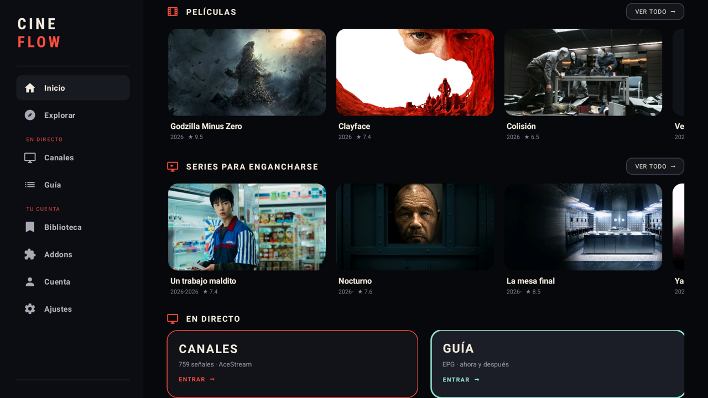
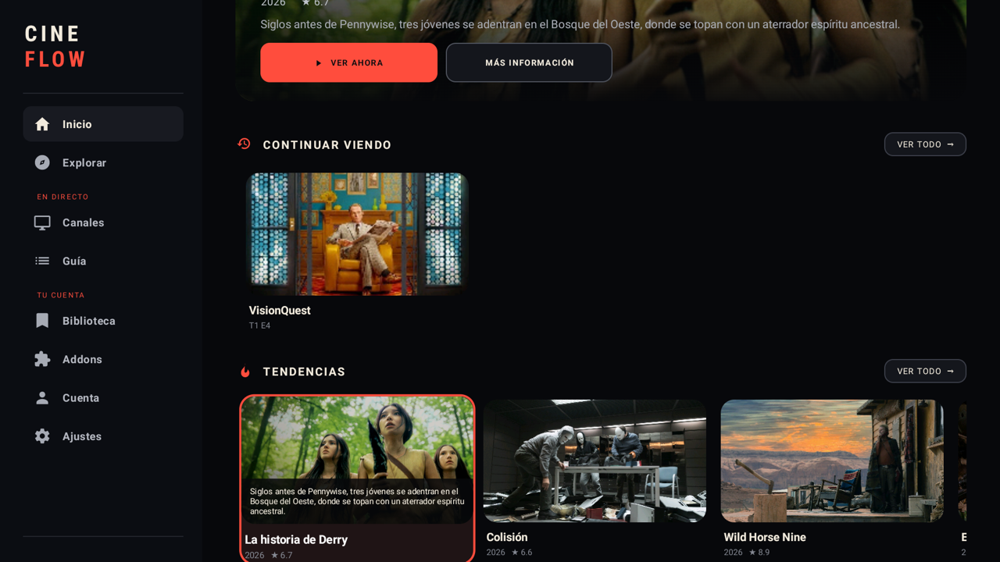
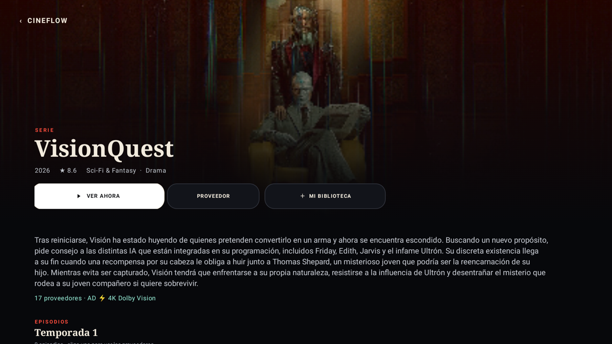
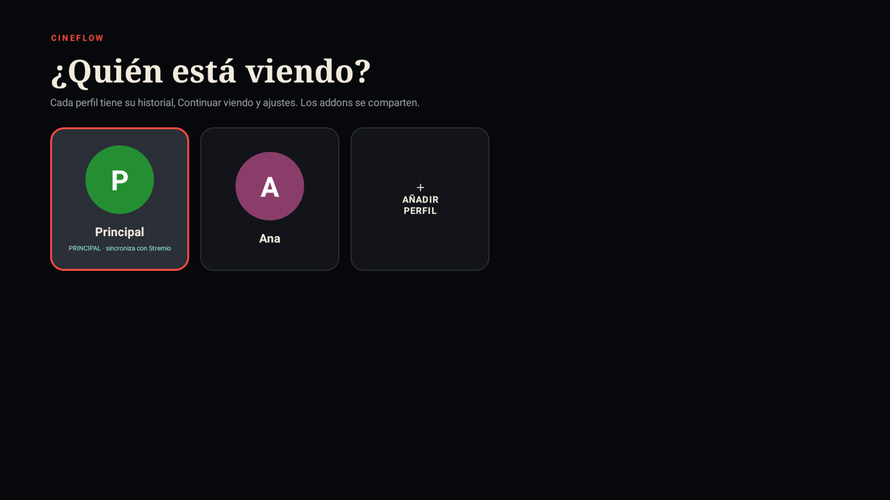
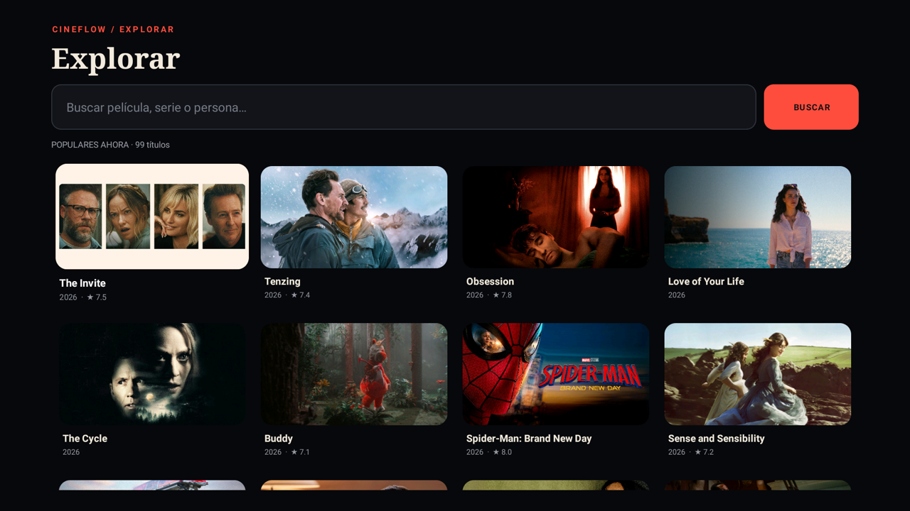
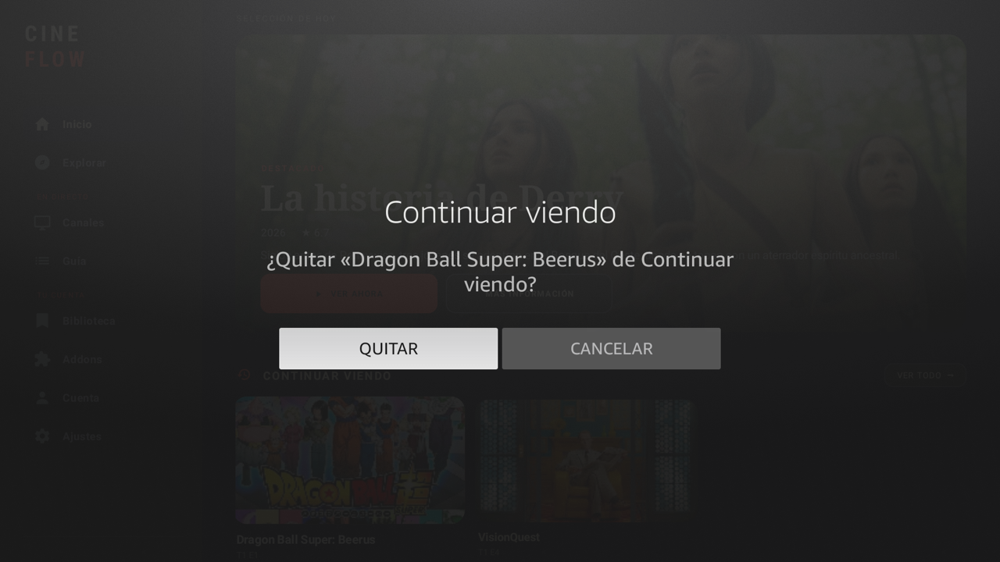
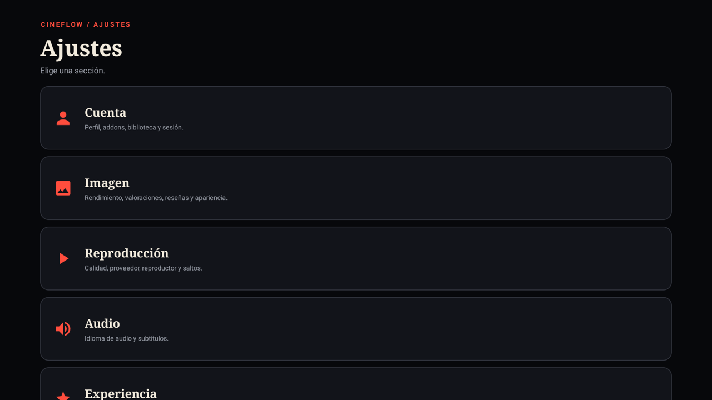
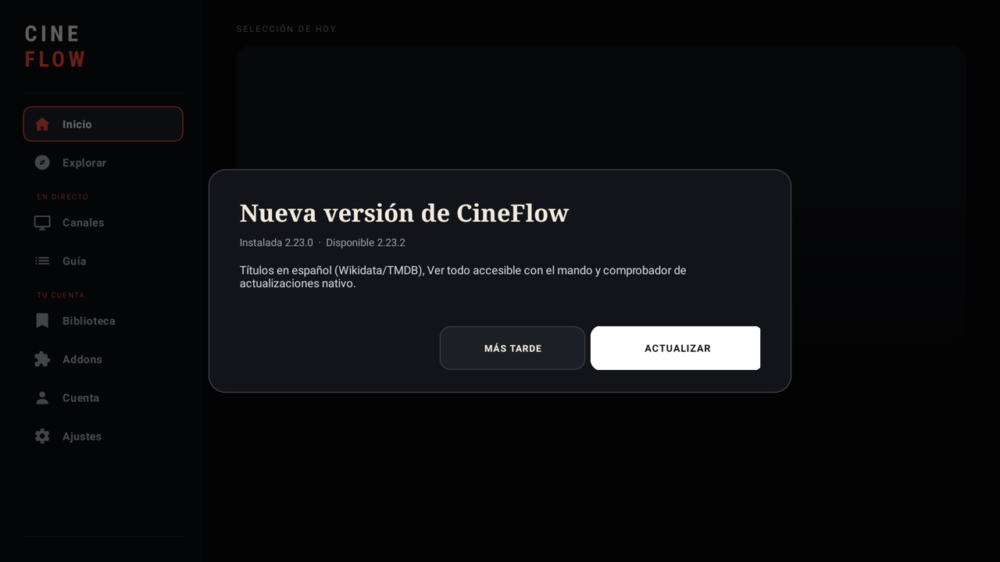

<h1 align="center">CineFlow TV</h1>

<p align="center">
  Un cliente nativo de Stremio para Fire TV y Android TV, con una interfaz propia y enfoque de mando.
</p>

<p align="center">
  
  
  
  
</p>

<p align="center">
  <a href="https://github.com/megandil/cineflow-tv/releases/latest"><strong>Descargar APK</strong></a>
  ·
  <a href="https://github.com/megandil/cineflow-tv/releases">Releases</a>
  ·
  <a href="#compilar">Compilar</a>
</p>

<p align="center">
  
</p>

## Qué es CineFlow

CineFlow es una aplicación **nativa** para televisores Fire TV y Android TV que utiliza tu cuenta de Stremio para acceder a tus addons, biblioteca y progreso. No es un navegador ni una capa WebView: la navegación, las fichas, los catálogos, los perfiles y el reproductor están construidos en Kotlin.

La app no aloja contenido. Los catálogos, metadatos y proveedores vienen de los addons que tengas instalados en tu cuenta de Stremio.

## Funcionalidades

### Inicio
- Interfaz cinematográfica con destacado, filas horizontales y tarjetas amplias.
- Catálogos de **TMDB en español** cuando el addon está instalado.
- Filas de **PeLis** para contenido en castellano.
- **Continuar viendo** con episodio, temporada y progreso.
- Sinopsis sobre la carátula al enfocar una tarjeta.
- Reborde coral y animación suave al navegar con el mando.
- Atajos a **Canales** y **Guía**.

### Cuenta y addons
- Vinculación mediante **QR de Stremio**.
- Addons de la cuenta, con instalación y eliminación nativa.
- Enlaces `stremio://` gestionados sin WebView.
- Catálogos de cada addon accesibles desde **Addons**.
- Compatibilidad con metadatos de TMDB y PeLis.
- Proveedores de Debrid, torrents y enlaces directos.

### Biblioteca y perfiles
- Biblioteca de la cuenta para el perfil **Principal**.
- Biblioteca **local e independiente** para perfiles secundarios.
- Perfiles con historial, Continuar viendo y ajustes separados.
- Addons y cuenta compartidos entre todos los perfiles.
- Selector **¿Quién está viendo?** al iniciar.
- Cambio de perfil desde **Ajustes → Cuenta → Cambiar de perfil**.
- Borrado de perfiles con el botón **MENÚ** del mando.

### Explorar
- Cuadrícula de contenido con categorías de TMDB.
- Búsqueda explícita, sin autobúsqueda.
- Resultados en español cuando TMDB está configurado en español.
- Borde y sinopsis al enfocar una tarjeta.

### Reproductor
- **ExoPlayer** nativo.
- Reproducción de torrents en el propio televisor.
- Subtítulos y pistas de audio.
- Saltos de intro/créditos compatibles.
- Barra de progreso, reloj y tiempo restante.
- Ajustes de calidad y audio por perfil.

### En Directo
- **Canales** con señales AceStream.
- **Guía EPG** con programación anterior, actual y siguiente.

### Actualizaciones
- Comprobación automática de la última release de GitHub.
- Aviso con **Actualizar** y **Más tarde**.
- **Ajustes → Buscar actualizaciones**.
- Descarga e instalación desde la propia app.

## Capturas

<table>
  <tr>
    <td align="center"><br><sub><b>Inicio</b> · catálogos en español</sub></td>
    <td align="center"><br><sub><b>Foco</b> · borde y sinopsis</sub></td>
  </tr>
  <tr>
    <td align="center"><br><sub><b>Ficha</b> · temporadas y proveedores</sub></td>
    <td align="center"><br><sub><b>Perfiles</b> · historial y ajustes separados</sub></td>
  </tr>
  <tr>
    <td align="center"><br><sub><b>Explorar</b> · cuadrícula y categorías</sub></td>
    <td align="center"><br><sub><b>Continuar viendo</b> · quitar con MENÚ</sub></td>
  </tr>
  <tr>
    <td align="center"><br><sub><b>Ajustes</b> · ajustes por perfil</sub></td>
    <td align="center"><br><sub><b>Actualización</b> · desde GitHub</sub></td>
  </tr>
</table>

## Instalación

1. Descarga el APK desde la [última release](https://github.com/megandil/cineflow-tv/releases/latest).
2. En Fire TV, activa la instalación de aplicaciones de fuentes desconocidas para la app que instala el APK.
3. Instala **CineFlow**.
4. Abre **Cuenta** y vincula tu cuenta de Stremio escaneando el QR.
5. Instala tus addons de proveedores (Torrentio, PeLis, etc.).
6. Opcional: instala **The Movie Database Addon** configurado en español para los catálogos y fichas en castellano.

> La primera actualización desde la app puede pedir permiso de Fire OS para instalar apps desconocidas. Concédelo una vez y vuelve a pulsar **Actualizar**.

## Perfiles

| Perfil | Historial | Continuar viendo | Ajustes | Biblioteca | Addons |
|---|---|---|---|---|---|
| Principal | Local | Local + Stremio | Propios | Cuenta Stremio | Compartidos |
| Secundario | Local | Local | Propios | Local | Compartidos |

Los perfiles secundarios no escriben su progreso en la cuenta de Stremio, para evitar que se mezcle con el perfil Principal.

## Compilar

Requisitos: JDK 17+ y Android SDK 35.

```bash
cd tv
./gradlew assembleRelease
```

El APK queda en `tv/app/build/outputs/apk/release/app-release.apk`.

## Versionado y releases

- La versión está en `tv/app/build.gradle.kts` (`cineflowVersion`).
- Se publica una release con etiqueta `vX.Y.Z`.
- El workflow `.github/workflows/cineflow-release.yml` construye y adjunta `CineFlow.apk`.
- La app consulta la release **latest** de GitHub y ofrece la actualización.
- Las releases deben firmarse siempre con la misma clave; la clave está en los secretos `CINEFLOW_KEYSTORE_B64` y `CINEFLOW_KEYSTORE_PASSWORD`.

## Estructura

```text
tv/                         App Android nativa
  app/src/main/java/        Kotlin: Inicio, fichas, perfiles, reproductor...
  app/src/main/res/         Recursos, iconos y tema
docs/screenshots/           Capturas del README
.github/workflows/          Build y publicación del APK
```

## Aviso

CineFlow es un cliente independiente y no está afiliado a Stremio, TMDB ni a los proveedores de contenido. No aloja ni distribuye películas, series o señales. El contenido reproducido depende exclusivamente de los addons y servicios que configures en tu cuenta.

## Licencia

GNU General Public License v3.0. Consulta [LICENSE](LICENSE).
